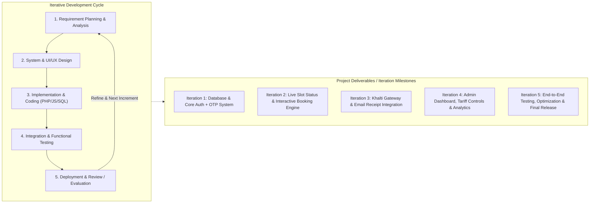
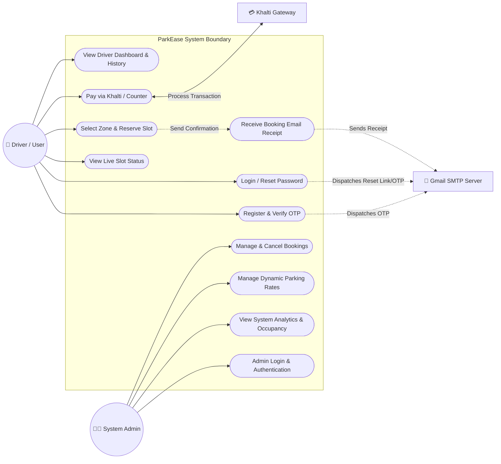
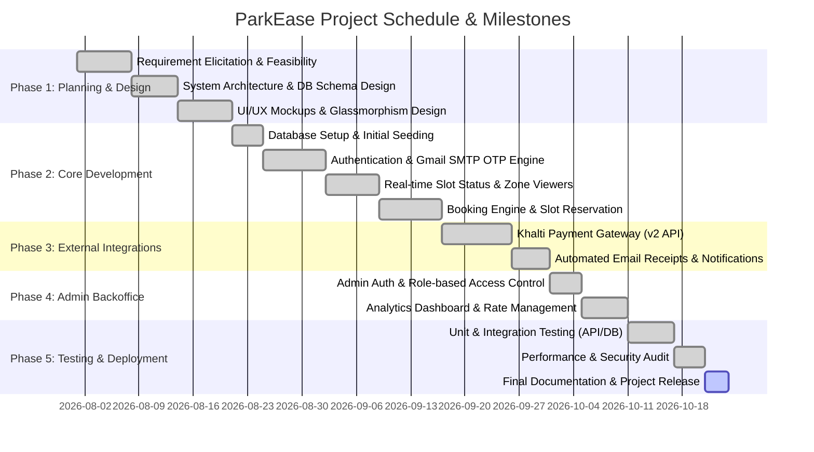
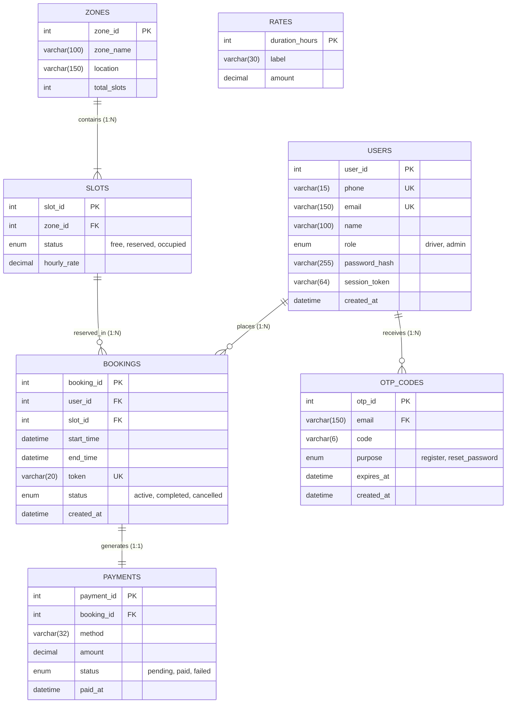
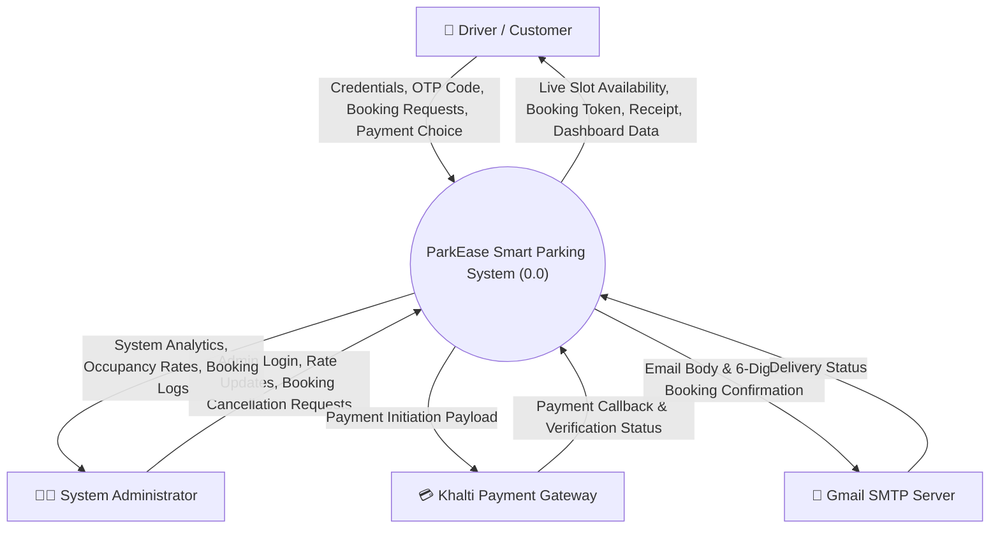
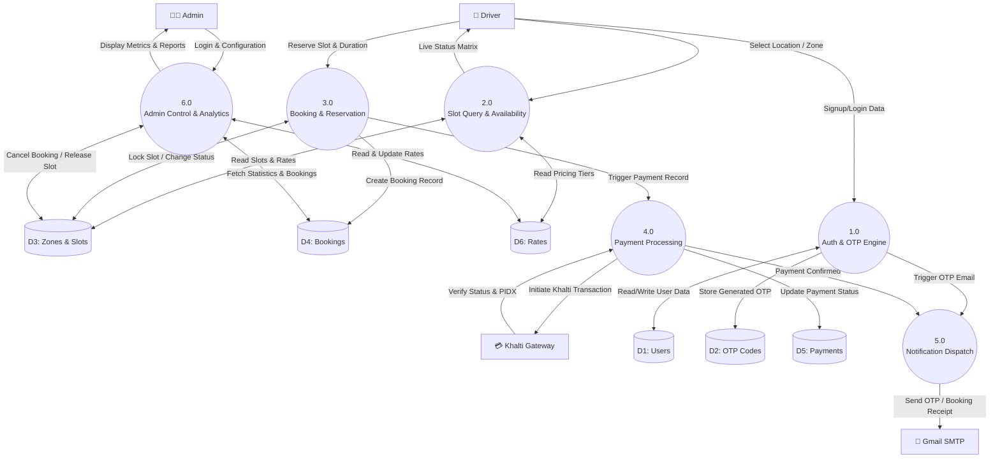
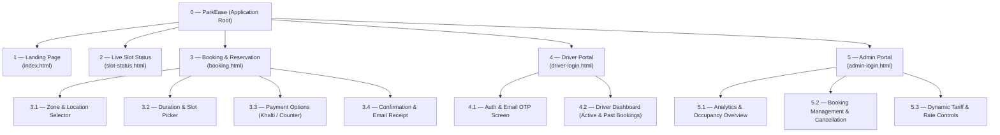

# ParkEase — Software Engineering Diagrams & System Models

This document contains the complete set of software engineering diagrams, process models, and project lifecycle charts for the **ParkEase Smart Parking System**. All diagrams are formatted using standard GitHub Flavored Markdown (Mermaid) syntax.

---

## Table of Contents
1. [Iterative Methodology Diagram (SDLC)](#1-iterative-methodology-diagram-sdlc)
2. [Use Case Diagram](#2-use-case-diagram)
3. [Gantt Chart (Project Timeline)](#3-gantt-chart-project-timeline)
4. [Entity Relationship Diagram (ERD)](#4-entity-relationship-diagram-erd)
5. [Context Level Diagram (DFD Level 0)](#5-context-level-diagram-dfd-level-0)
6. [Data Flow Diagram (DFD Level 1)](#6-data-flow-diagram-dfd-level-1)
7. [System Architecture Diagram](#7-system-architecture-diagram)
8. [Interface Structure (Navigation Site Map)](#8-interface-structure-navigation-site-map)

---

## 1. Iterative Methodology Diagram (SDLC)

ParkEase followed an **Iterative & Incremental Agile Development Model**, refining the system through continuous cycles of planning, design, implementation, testing, and feedback.



---

## 2. Use Case Diagram

Identifies the interactions between the primary actors (**Driver/User**, **Admin**) and external secondary systems (**Khalti Payment Gateway**, **Gmail SMTP Mailer**).



---

## 3. Gantt Chart (Project Timeline)

Detailed project schedule showing phases, task durations, and critical milestones across the development lifecycle.



---

## 4. Entity Relationship Diagram (ERD)

Physical database model highlighting primary keys, foreign keys, cardinality, and data types from `schema.sql`.



---

## 5. Context Level Diagram (DFD Level 0)

Shows the system boundary, central software package, and high-level input/output flows between external entities.



---

## 6. Data Flow Diagram (DFD Level 1)

Decomposes the system into functional sub-processes, showing internal data stores.



---

## 7. System Architecture Diagram

Multi-tier modular software architecture outlining the flow from frontend presentation to external microservices.

```mermaid
graph TB
    subgraph Presentation_Layer["Client / Presentation Layer"]
        UI_Home["Landing & Info (index.html)"]
        UI_Slots["Slot Status Board (slot-status.html)"]
        UI_Book["Booking & Checkout (booking.html)"]
        UI_Driver["Driver Portal & History (driver-login/dashboard.html)"]
        UI_Admin["Admin Management Portal (admin-login/dashboard.html)"]
        API_JS["Client API Engine (api.js)"]
        
        UI_Home & UI_Slots & UI_Book & UI_Driver & UI_Admin --> API_JS
    end

    subgraph Backend_Layer["Application & API Layer (PHP 8.x)"]
        Router["HTTP Router / Endpoints"]
        
        subgraph Modules["Functional Services"]
            AuthMod["Authentication & OTP Handler<br>(send-otp.php, user-auth.php)"]
            SlotMod["Slot & Zone Engine<br>(slots.php, slot-status.php)"]
            BookMod["Booking Controller<br>(bookings.php)"]
            PayMod["Khalti Payment Handler<br>(initiate.php, verify.php)"]
            AdminMod["Admin Services & Stats<br>(stats.php, update-rates.php)"]
            MailMod["PHPMailer Service<br>(mailer.php, gmail_otp.php)"]
        end

        DB_Helper["Database Layer (db.php / PDO)"]

        API_JS -->|REST Requests (JSON)| Router
        Router --> AuthMod & SlotMod & BookMod & PayMod & AdminMod
        AuthMod & BookMod --> MailMod
        AuthMod & SlotMod & BookMod & PayMod & AdminMod --> DB_Helper
    end

    subgraph Persistence_Layer["Database Layer (MySQL / MariaDB)"]
        DB[("MySQL Database<br>InnoDB Tables")]
        DB_Helper <-->|Prepared Statements / PDO| DB
    end

    subgraph External_Services["External Services & APIs"]
        Ext_Khalti["Khalti Payment Gateway v2"]
        Ext_SMTP["Google Gmail SMTP Server"]
        
        PayMod <-->|HTTPS cURL (Bearer Auth)| Ext_Khalti
        MailMod -->|SMTP / TLS (Port 587)| Ext_SMTP
    end
```

---

## 8. Interface Structure (Navigation Site Map)

Hierarchical site tree showing screen navigation and sub-component breakdown across driver and administrative portals.


